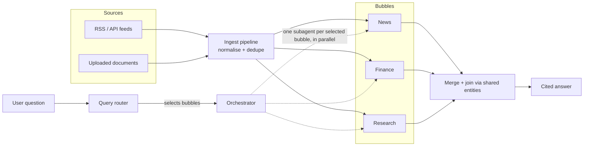

<div align="center">

# OmniStream RAG

**Real-time, multi-graph retrieval-augmented generation.**

Feeds and documents go in continuously. Cited, merged answers come out.

<p>
  
  
  
  
  
</p>

</div>

---

## Overview

OmniStream continuously ingests RSS feeds, APIs and uploaded documents into separate
knowledge graphs called **bubbles**, one per domain (for example News, Finance and
Research). When a question comes in, an orchestrator picks the relevant bubbles, runs
one subagent per bubble, and merges their findings into a single cited answer.

For the design rationale see [`omnistream-rag.md`](omnistream-rag.md). For the full
specification see [`omnistream-rag-specification.md`](omnistream-rag-specification.md).

## Key Features

| Feature | What it does |
|---|---|
| **Bubbles** | One knowledge graph per domain. Seeded with News, Finance and Research. |
| **Continuous ingestion** | Polls RSS and API sources on a schedule, with backoff on failures, and accepts uploaded documents. |
| **Normalisation and dedupe** | Items are normalised and deduplicated at intake before they reach a bubble. |
| **Query routing** | Selects the bubbles relevant to a question. |
| **Orchestrated subagents** | One subagent per bubble runs in parallel, then the orchestrator merges the results. |
| **Hybrid retrieval** | Classic, sparse, hybrid and graph retrieval, combined with Reciprocal Rank Fusion. |
| **Cited answers** | Every merged answer carries citations back to its sources. |
| **Own graph retrieval** | Passage-anchored seeding, 2-hop expansion, PageRank and weighted RRF, with an optional local cross-encoder reranker. |
| **Alias merging** | Abbreviations and aliases (for example "WHO" and "World Health Organization") are linked at ingestion; existing graphs can be merged and reverted with a manifest. |
| **Local embeddings** | `BAAI/bge-large-en-v1.5` (1024-dim) runs on the local GPU; no embedding API is needed. |
| **Multi-hop benchmarks** | Loaders and EM/F1 + passage Recall@k scoring for MuSiQue, 2WikiMultiHopQA and HotpotQA (HippoRAG 2 subsets). |
| ⏳ **Per-bubble half-life** | Each bubble has its own half-life setting (seeded at 3, 30 and 365 days). |
| **Snapshot replay** | Record a snapshot and re-inject it through intake for repeatable runs. |
| **Evaluation harness** | LLM-judge evaluation runs, plus a real-data corpus builder. |
| **Web UI and HTTP API** | Server-rendered Jinja2 + HTMX pages with no build step, and a FastAPI backend. |

## Architecture



## Results so far

Full logs: [`docs/IMPROVEMENT_LOG.md`](docs/IMPROVEMENT_LOG.md); raw reports: [`docs/eval/bench/`](docs/eval/bench/).

### Retrieval check (HippoRAG protocol, full corpora, 300 questions, passage Recall@2 / @5)

| Retriever | MuSiQue | 2Wiki | HotpotQA |
|---|---|---|---|
| BM25 (ours) | 33.8 / 44.7 | 55.5 / 63.7 | 56.3 / 73.3 |
| BM25 (HippoRAG 1 paper) | 32.3 / 41.2 | 51.8 / 61.9 | 55.4 / 72.2 |
| HippoRAG 1, ColBERTv2 (paper) | 40.9 / 51.9 | **70.7 / 89.1** | 60.5 / 77.7 |
| **bge-large-en-v1.5 (ours, local GPU)** | **41.2 / 55.7** | 64.8 / 71.3 | **75.2 / 87.7** |

Our BM25 reproduces the published BM25 within about 3 points, which validates the harness.

### End-to-end QA: full corpora, 200 questions per dataset (test run)

OpenIE graph over the full released corpus (MuSiQue 11,656, 2Wiki 6,119, HotpotQA 9,811 passages),
200 questions per dataset (seed 0; the MuSiQue development questions are excluded). Short answers,
EM / token F1 / passage Recall@5 (%), answering model `deepseek/deepseek-v4.1-flash-1017`.
Own retrieval uses passage seeding, the local reranker and HippoRAG 2-style passage nodes.

| Configuration | MuSiQue | 2Wiki | HotpotQA |
|---|---|---|---|
| Closed book (no retrieval) | 7.5 / 12.8 / - | 30.5 / 33.6 / - | 29.5 / 38.2 / - |
| External (LlamaIndex) | 14.5 / 16.7 / 40.9 | 35.0 / 37.6 / 64.4 | 44.0 / 54.5 / 74.0 |
| Classic RAG | not run | 49.5 / 53.7 / 69.9 | not run |
| Own retrieval | 23.0 / 27.0 / 56.3 | 50.5 / 55.0 / 86.2 | 48.0 / 60.0 / 80.8 |
| **Own retrieval + subagents** | **37.0 / 47.3** / 45.9 | **71.5 / 77.1** / 71.9 | **62.0 / 75.6** / 71.2 |
| HippoRAG 1 (paper, EM / F1) | 19.2 / 29.8 | 46.6 / 59.5 | 41.8 / 55.0 |
| IRCoT + HippoRAG (paper, EM / F1) | 21.9 / 33.3 | 47.7 / 62.7 | 45.7 / 59.2 |

Own retrieval + subagents beats the published HippoRAG 1 QA by 17-20 F1 points on all three
datasets. Caveats: the papers use different answering models and 1,000 questions; at n=200 the 95%
bootstrap intervals are about +-6-7 points. Reports: [`docs/eval/bench/`](docs/eval/bench/).

### End-to-end QA: MuSiQue, 50 questions (seed 0), 928-passage slice corpus (development set)

Short answers, SQuAD-normalised EM / token F1, answering model `deepseek/deepseek-v4.1-flash-1017`.

| Configuration | EM | F1 | Recall@2 | Recall@10 | Cost ($) |
|---|---|---|---|---|---|
| Closed book (no retrieval) | 10.0 | 13.1 | - | - | 0.001 |
| External (LlamaIndex) | 20.0 | 24.4 | 45.5 | 45.5 | 0.003 |
| Classic RAG | 36.0 | 44.0 | 45.5 | 78.8 | 0.017 |
| Graphiti | 34.0 | 40.0 | 43.7 | 72.3 | 0.025 |
| Own retrieval | 34.0 | 38.6 | **52.5** | 77.5 | 0.024 |
| **Own retrieval + subagents** | **48.0** | **60.2** | 45.3 | **83.2** | 0.300 |

95% bootstrap intervals are about +-13 EM points at n=50. Published HippoRAG 1 MuSiQue QA (EM / F1:
HippoRAG 19.2 / 29.8, IRCoT + HippoRAG 21.9 / 33.3) uses the full 11,656-passage corpus and 1,000
questions, so it is context, not a like-for-like comparison.

## Requirements

| Requirement | Notes |
|---|---|
| **Python 3.12** | Pinned in `.python-version`. Managed with [uv](https://docs.astral.sh/uv/). |
| **uv** | Installs dependencies and runs the `omni` CLI. |
| **Docker** | Runs Neo4j 5.26 through `docker-compose.yml`. |
| **OpenAI-compatible LLM endpoint** | DeepSeek by default (`https://api.deepseek.com/v1`). |

## Setup

```bash
cp .env.example .env      # then fill in the values below
uv sync                   # creates .venv and installs dependencies
docker compose up -d      # starts Neo4j 5.26 on ports 7474 / 7687
```

<details>
<summary><b>Environment variables</b></summary>

| Variable | Purpose |
|---|---|
| `LLM_BASE_URL` | OpenAI-compatible endpoint (default `https://api.deepseek.com/v1`) |
| `LLM_API_KEY` | API key for the LLM endpoint |
| `LLM_MODEL` | Model used for extraction and answering |
| `JUDGE_MODEL` | Model used by the evaluation judge |
| `NEO4J_URI` / `NEO4J_USER` / `NEO4J_PASSWORD` | Neo4j connection. The password is required by `docker-compose.yml`. |
| `OMNI_ALLOWED_HOSTS` | Extra hosts allowed when serving beyond localhost (comma-separated) |
| `FINNHUB_API_KEY` | Optional. Enables the Finnhub source when seeding. |

</details>

## Usage

The `omni` CLI is the entry point:

```bash
uv run omni seed                  # create the default bubbles and sources
uv run omni serve                 # start API + UI at http://127.0.0.1:8000
uv run omni replay <snapshot>     # re-inject a recorded snapshot through intake
uv run omni eval --snapshot <name> --dataset eval-v2 --split dev
uv run omni realdata collect --name real-v2   # build the real-data corpus

# multi-hop benchmarks (data from the HippoRAG 2 release under data/bench/hipporag)
uv run omni eval bench-retrieval --dataset musique --n 300            # retrieval-only check, no LLM
uv run omni eval bench-ingest --dataset musique --n 50 --corpus slice  # build the benchmark graph
uv run omni eval bench-qa --dataset musique --n 50 --snapshot bench-musique-n50-s0
```

<details>
<summary><b>Command notes</b></summary>

| Command | Notes |
|---|---|
| `omni seed` | Idempotent. Skips the Finnhub source with a warning unless `FINNHUB_API_KEY` is set. |
| `omni serve` | Binds to `127.0.0.1:8000` by default. Use `--host` and `--port` to change this. Set `OMNI_ALLOWED_HOSTS` to serve beyond localhost. |
| `omni replay <snapshot>` | Re-injects a recorded snapshot in polled order. |
| `omni eval` | Requires `--snapshot`. `--dataset` accepts `eval-v1`, `eval-v2` or `real-v2`. |
| `omni realdata collect` | Requires `--name`. Optional `--since` and `--until`. |
| `omni eval bench-ingest` | Resumable. `--limit-passages N` for a cost probe, `--dry-run` for counts only. |
| `omni eval bench-qa` | Scores closed_book, external, classic, graphiti, own and own+subagents. `--limit-questions N` then `--resume` to extend. |

</details>

### Web UI

Server-rendered **Jinja2 + HTMX** pages, served by `uv run omni serve`. No build step.

| Page | Purpose |
|---|---|
| [`/ui/ask`](http://127.0.0.1:8000/ui/ask) | Ask a question and get a cited answer |
| [`/ui/bubbles`](http://127.0.0.1:8000/ui/bubbles) | Browse bubbles and their graphs |
| `/ui/sources`, `/ui/unsorted` | Manage sources and assign unsorted items |
| [`/ui/settings`](http://127.0.0.1:8000/ui/settings) | Configure and test the LLM connection |
| [`/ui/eval`](http://127.0.0.1:8000/ui/eval) | Start and inspect evaluation runs |

## HTTP API

The main endpoints are listed below. Interactive OpenAPI docs are served at
[`/docs`](http://127.0.0.1:8000/docs) while the server is running.

| Method | Path | Purpose |
|---|---|---|
| `POST` | `/query` | Ask a question across bubbles |
| `GET` `POST` `DELETE` | `/bubbles` | List, create or delete bubbles |
| `GET` `POST` | `/sources` | List or create sources |
| `POST` | `/sources/{id}/poll` | Poll a source now |
| `POST` | `/documents` | Upload a document for ingestion |
| `GET` | `/items` | List ingested items |
| `POST` | `/items/{id}/assign` | Assign an item to a bubble |
| `GET` `POST` | `/eval/runs` | List or start evaluation runs |
| `GET` `PUT` | `/settings` | Read or update settings |

<details>
<summary>All routes</summary>

| Method | Path | Purpose |
|---|---|---|
| `GET` | `/bubbles/{id}` | Get one bubble |
| `GET` | `/bubbles/map` | Bubble map |
| `GET` | `/bubbles/{id}/graph` | A bubble's graph |
| `GET` | `/bubbles/{id}/counts` | A bubble's counts |
| `PATCH` | `/sources/{id}` | Update a source |
| `GET` | `/items/{id}/text` | Plain text of an item |
| `POST` | `/settings/test` | Test the LLM connection |
| `GET` | `/eval/runs/{id}` | One evaluation run |
| `GET` | `/eval/runs/{id}/csv` | Evaluation run as CSV |

</details>

## Project layout

```
src/omnistream/
├── sources/     RSS, API and document connectors, snapshot replay
├── ingest/      intake, normalisation, dedupe, queue, scheduler, pipeline
├── graph/       Graphiti/Neo4j stores, grounding, entity linking, chunks
├── db/          SQL repository and tables
├── router/      bubble catalogue and query routing
├── agents/      orchestrator, per-bubble subagents and their tools
├── retrieval/   classic, sparse, hybrid and graph retrieval, fusion, citations
├── api/         FastAPI application
├── ui/          Jinja2 + HTMX web interface
├── eval/        datasets, LLM judge, metrics, calibration, real-data corpus
└── cli.py       `omni` command
scripts/         fixture recording, reasoning checks, real-data tooling
tests/           unit, integration (Docker/Neo4j) and live (LLM) tests
docs/            evaluation results, real-data reports, diagnostics, plans
```

## Testing

```bash
uv run pytest                     # unit tests (default)
uv run pytest -m integration      # needs Docker / Neo4j
uv run pytest -m live             # needs LLM_API_KEY
uv run ruff check .
```

> [!NOTE]
> Some unit tests in [`tests/unit/test_real_question_repairs.py`](tests/unit/test_real_question_repairs.py)
> read the real-data corpus under `data/`, which is gitignored. Build it with
> `omni realdata collect` (see [`scripts/realdata/README.md`](scripts/realdata/README.md))
> or those tests will fail with `FileNotFoundError`.

## Documentation

| Document | Contents |
|---|---|
| [`omnistream-rag.md`](omnistream-rag.md) | Goals, concepts, architecture, design decisions |
| [`omnistream-rag-specification.md`](omnistream-rag-specification.md) | Full specification |
| [`docs/IMPROVEMENT_LOG.md`](docs/IMPROVEMENT_LOG.md) | Running log of improvements |
| [`docs/llm-reasoning.md`](docs/llm-reasoning.md) | How LLM reasoning is used |
| [`docs/eval/`](docs/eval/) | Evaluation runs and results |
| [`docs/realdata/`](docs/realdata/) | Real-data corpus quality, validation and cost reports |
| [`docs/diagnostics/`](docs/diagnostics/) | Evaluation diagnoses and fixes |
| [`docs/superpowers/plans/`](docs/superpowers/plans/) | Implementation plans |

## Contributors

| Contributor | Areas |
|---|---|
| **HF5478 (Hocine)** | Sources, ingestion pipeline, storage, routing, API |
| **Mohammed Elmejrab** | Retrieval, agents, evaluation |
| **Omar** | Graph |
