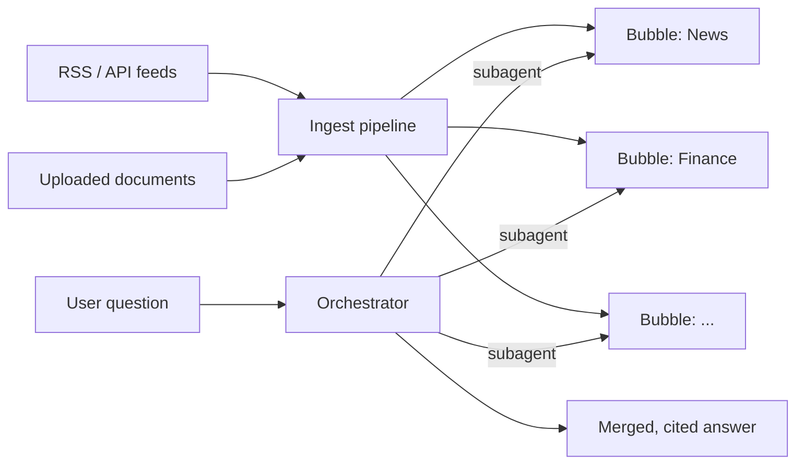

# OmniStream RAG

A real-time, multi-graph retrieval-augmented generation (RAG) system. OmniStream
continuously ingests RSS feeds, APIs and uploaded documents into separate knowledge
graphs called **bubbles**, one per domain (e.g. News, Finance, Research). When a
question comes in, an orchestrator picks the relevant bubbles, runs one subagent per
bubble, and merges their findings into a single cited answer.



For the design rationale see [`omnistream-rag.md`](omnistream-rag.md); for the full
specification see [`omnistream-rag-specification.md`](omnistream-rag-specification.md).

## Requirements

- Python 3.12 and [uv](https://docs.astral.sh/uv/)
- Docker (for Neo4j)
- An OpenAI-compatible LLM endpoint (DeepSeek by default)

## Setup

```bash
cp .env.example .env      # then fill in the values below
uv sync                   # creates .venv and installs dependencies
docker compose up -d      # starts Neo4j 5.26 on ports 7474 / 7687
```

| Variable | Purpose |
|---|---|
| `LLM_BASE_URL` | OpenAI-compatible endpoint (default `https://api.deepseek.com/v1`) |
| `LLM_API_KEY` | API key for the LLM endpoint |
| `LLM_MODEL` | Model used for extraction and answering |
| `JUDGE_MODEL` | Model used by the evaluation judge |
| `NEO4J_URI` / `NEO4J_USER` / `NEO4J_PASSWORD` | Neo4j connection (password is required by `docker-compose.yml`) |
| `OMNI_ALLOWED_HOSTS` | Extra hosts allowed when serving beyond localhost (comma-separated) |
| `FINNHUB_API_KEY` | Optional; enables the Finnhub source when seeding |

## Usage

The `omni` CLI is the entry point:

```bash
uv run omni seed                  # create the default bubbles and sources
uv run omni serve                 # start API + UI at http://127.0.0.1:8000
uv run omni replay <snapshot>     # re-inject a recorded snapshot through intake
uv run omni eval --snapshot <name> --dataset eval-v2 --split dev
uv run omni realdata collect --name real-v2   # build the real-data corpus
```

### Web UI

Server-rendered Jinja2 + HTMX pages, no build step:

| Page | Purpose |
|---|---|
| `/ui/ask` | Ask a question and get a cited answer |
| `/ui/bubbles` | Browse bubbles and their graphs |
| `/ui/sources`, `/ui/unsorted` | Manage sources and assign unsorted items |
| `/ui/settings` | Configure and test the LLM connection |
| `/ui/eval` | Start and inspect evaluation runs |

### HTTP API

Main endpoints: `POST /query`, `GET|POST|DELETE /bubbles`, `GET|POST /sources`,
`POST /sources/{id}/poll`, `POST /documents`, `GET /items`,
`POST /items/{id}/assign`, `GET|POST /eval/runs`, `GET|PUT /settings`.
Interactive docs are at `/docs` while the server is running.

## Project layout

```
src/omnistream/
├── sources/     RSS, API and document connectors, snapshot replay
├── ingest/      intake, normalisation, dedupe, queue, scheduler, pipeline
├── graph/       Graphiti/Neo4j stores, grounding, entity linking, chunks
├── db/          SQL repository and tables
├── router/      bubble catalogue and query routing
├── agents/      orchestrator, per-bubble subagents and their tools
├── retrieval/   classic, sparse, hybrid and graph retrieval, fusion, citations
├── api/         FastAPI application
├── ui/          Jinja2 + HTMX web interface
├── eval/        datasets, LLM judge, metrics, calibration, real-data corpus
└── cli.py       `omni` command
scripts/         fixture recording, reasoning checks, real-data tooling
tests/           unit, integration (Docker/Neo4j) and live (LLM) tests
docs/            evaluation results, real-data reports, diagnostics, plans
```

## Testing

```bash
uv run pytest                     # unit tests (default)
uv run pytest -m integration      # needs Docker / Neo4j
uv run pytest -m live             # needs LLM_API_KEY
uv run ruff check .
```

Some unit tests in `tests/unit/test_real_question_repairs.py` read the real-data
corpus under `data/`, which is gitignored. Build it with `omni realdata collect`
(see [`scripts/realdata/README.md`](scripts/realdata/README.md)) or those tests will
fail with `FileNotFoundError`.

## Documentation

| Path | Contents |
|---|---|
| [`omnistream-rag.md`](omnistream-rag.md) | Goals, concepts, architecture, design decisions |
| [`omnistream-rag-specification.md`](omnistream-rag-specification.md) | Full specification |
| [`docs/IMPROVEMENT_LOG.md`](docs/IMPROVEMENT_LOG.md) | Running log of improvements |
| [`docs/llm-reasoning.md`](docs/llm-reasoning.md) | How LLM reasoning is used |
| [`docs/eval/`](docs/eval/) | Evaluation runs and results |
| [`docs/realdata/`](docs/realdata/) | Real-data corpus quality, validation and cost reports |
| [`docs/diagnostics/`](docs/diagnostics/) | Evaluation diagnoses and fixes |
| [`docs/superpowers/plans/`](docs/superpowers/plans/) | Implementation plans |

## Contributors

- HF5478: sources, ingestion pipeline, storage, routing, API
- Mohammed Elmejrab: graph, retrieval, agents, evaluation
