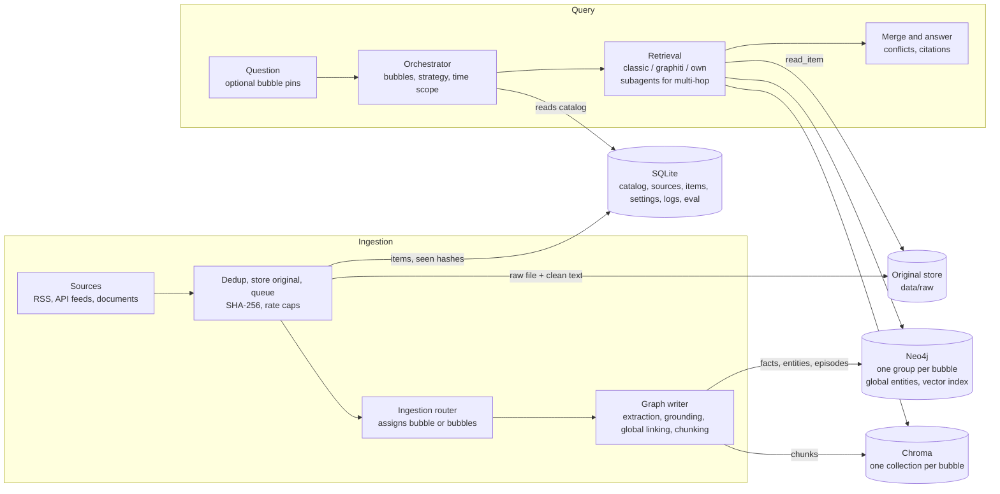
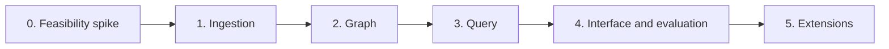

# OmniStream RAG: System Specification

**Real-Time Multi-Source Graph Retrieval-Augmented Generation**

Version 1.0 · October 19, 2026

---

## Contents

1. [Overview](#1-overview)
2. [Scope](#2-scope)
3. [Requirements Traceability](#3-requirements-traceability)
4. [System Architecture](#4-system-architecture)
5. [Technology Stack](#5-technology-stack)
6. [Component Specifications](#6-component-specifications)
7. [Data Model](#7-data-model)
8. [Evaluation](#8-evaluation)
9. [Design Decisions](#9-design-decisions)
10. [Delivery Roadmap](#10-delivery-roadmap)
11. [Risks and Mitigations](#11-risks-and-mitigations)
12. [Open Issues](#12-open-issues)
13. [Appendix: Repository and Configuration](#13-appendix-repository-and-configuration)

---

## 1. Overview

### 1.1 Purpose

OmniStream RAG is a question-answering system that continuously ingests streaming data from RSS feeds, APIs and uploaded documents, turns it into a time-aware knowledge graph, and answers questions with a large language model (LLM) grounded in that graph. The system is designed to show, with a reproducible evaluation, that graph-based retrieval beats classical vector-based retrieval on multi-hop and time-sensitive questions over streaming data.

### 1.2 Key Concepts

| Concept | Definition |
| --- | --- |
| **Bubble** | A domain knowledge graph (for example News, Finance, Research) with its own name, description and data partition. Bubbles are created, inspected and deleted from the user interface. |
| **Ingestion router** | An LLM-assisted component that assigns each incoming item to one or more bubbles. |
| **Orchestrator** | The query-time component that selects the relevant bubbles and decides between a direct search and a multi-hop investigation. |
| **Subagent** | A bounded tool-using agent that investigates a single bubble during multi-hop queries. |
| **Global entity** | A cross-bubble identity node that links equivalent entities in different bubbles (for example "Apple" in News and in Finance). |
| **Item** | One ingested unit (a feed entry, API record or document). Its original and clean text are stored and referenced by every fact derived from it. |

### 1.3 Retrieval Modes

All modes read the same underlying data, so measured differences come from the retrieval method alone.

| Mode | Method |
| --- | --- |
| `classic` | Vector search over raw text chunks (the classical RAG baseline) |
| `graphiti` | Graphiti's built-in hybrid search (BM25 + vector + graph distance) over facts |
| `own` | Custom graph algorithm: entity seeding, bounded hop expansion, Personalized PageRank and Reciprocal Rank Fusion |

---

## 2. Scope

### 2.1 Objectives

1. Ingest RSS, API and document sources continuously, with deduplication, into user-defined bubbles.
2. Build and update the knowledge graph in real time with LLM-based entity and relation extraction, time-aware facts and full provenance back to the stored original.
3. Route each item to the correct bubble(s) on ingestion and each question to the correct bubbles at query time, using subagents for multi-hop questions.
4. Provide three retrieval modes, selectable globally and per query.
5. Generate answers from the LLM plus graph context, with every claim citing a stored source.
6. Show the gain over classical RAG with a fixed, reproducible evaluation, running on a single laptop with no cloud infrastructure other than the LLM API.

### 2.2 Out of Scope

- Multi-user accounts, permissions, hosting and large-scale deployment.
- Hierarchical bubbles (sub-bubbles).
- Local LLM inference.
- Learned routing from user feedback (ratings are logged for future use).
- Multimedia (image, audio, video) ingestion.
- Model training or fine-tuning.

### 2.3 Constraints

| Constraint | Implication |
| --- | --- |
| Target hardware: Apple M1, 8 GB RAM | Combined container and application footprint ≤ 4 GB; no local LLM |
| Open-source tools; MIT/Apache-licensed models where possible | Licences recorded per component (Section 5) |
| No heavy cloud infrastructure | All services run locally except the LLM API |
| Provider independence | Any OpenAI-compatible LLM endpoint is supported through configuration |
| Emphasis on correctness over scale | Evaluation focuses on graph correctness, retrieval relevance and answer quality |

---

## 3. Requirements Traceability

| Requirement | Component | Implementation |
| --- | --- | --- |
| Streaming ingestion: RSS, API, documents | C1, C2 | Scheduled pollers, document upload, deduplicating queue |
| Streaming ingestion: logs, user queries | C1 (optional) | Log-tail source type; query-log bubble |
| Entity and relation extraction with NLP/LLM | C4 | Graphiti extraction via the configured LLM, with a grounding check |
| Graph database | Stack | Neo4j Community 5 |
| Vector database for hybrid retrieval | Stack, C4, C5 | Chroma (chunk store) and the Neo4j vector index (entities and facts) |
| Graph-based retrieval algorithm | C5 | `own` and `graphiti` modes |
| LLM integration (local or API) | Stack | OpenAI-compatible API client |
| Python backend | Stack | Python 3.12, FastAPI |
| Real-time knowledge graph updates | C2, C4 | Incremental per-item writes, bi-temporal facts |
| Query interface | C6 | Web UI and REST API |
| Multiple data sources | C1 | rss / api / document source types |
| Dynamic graph updates | C4 | New facts invalidate superseded ones (`HISTORICAL`) |
| Answers from LLM + graph context | C5 | Ranked facts, optional original text, citations |
| Better reasoning than classical RAG | C5, C7 | Six-configuration comparative evaluation |
| Open-source tools and models | Stack | See licence column, Section 5 |
| No heavy cloud infrastructure | Stack | Local services; only the LLM is remote |

---

## 4. System Architecture

### 4.1 Overview

The system has two independent paths that share a set of stores. The **ingestion path** turns source items into graph facts and text chunks. The **query path** reads the bubble catalog, retrieves from the selected bubbles and produces a cited answer.



### 4.2 Provenance

Every fact, episode and chunk carries an `item_id`, and every item references its stored raw file and clean text. Any statement in an answer can therefore be traced to, and displayed from, its original source.

### 4.3 Bubble Isolation and Cross-Bubble Linking

Each bubble maps to one Graphiti `group_id`. Graphiti deduplicates entities only within a group (verified in the Graphiti source: candidate search in `resolve_extracted_nodes` is limited to the node's own `group_id`). A global entity linker joins equivalent entities across bubbles with `SAME_AS` edges, which lets graph traversal cross bubble boundaries while each domain partition stays clean.

---

## 5. Technology Stack

| Layer | Choice | Licence |
| --- | --- | --- |
| Backend | Python 3.12, FastAPI | PSF, MIT |
| Tooling | `uv`, `ruff`, `pytest`, git | MIT/Apache, MIT, MIT, GPLv2 |
| Feed polling | `feedparser`, APScheduler, `httpx` | BSD, MIT, BSD |
| Document parsing | `pypdf`, `python-docx` | BSD, MIT |
| Graph construction | Graphiti (`graphiti-core`) via `OpenAIGenericClient` | Apache 2.0 |
| Graph and vector store | Neo4j Community 5 with built-in vector index | GPLv3 |
| Chunk vector store | Chroma, embedded persistent client | Apache 2.0 |
| Application state | SQLite via SQLModel | Public domain, MIT |
| LLM | Any OpenAI-compatible API through the `openai` client; DeepSeek initially | Client Apache 2.0; DeepSeek weights MIT |
| Embeddings | `bge-small-en-v1.5` (384 dimensions), local via `sentence-transformers` | MIT, Apache 2.0 |
| Graph computation | `networkx`, `rapidfuzz` | BSD, MIT |
| External baseline | LlamaIndex default RAG pipeline (evaluation only) | MIT |
| Containers | Colima, Docker Compose | MIT, Apache 2.0 |
| User interface | Server-rendered HTML with HTMX; `vis-network` for graph views | BSD; Apache 2.0 / MIT |

**Embeddings are always local.** Many OpenAI-compatible providers offer no embeddings endpoint, and changing the embedding model requires re-indexing, so embeddings are fixed independently of the LLM provider.

**Memory budget.** The Colima VM is allocated 3 GB, with Neo4j at a 1 GB heap and 512 MB page cache. The application, Chroma and the embedding model run natively (estimated at about 600 MB). Target peak: ≤ 4 GB.

---

## 6. Component Specifications

Parameters marked *(default)* are tunable starting values, not measured optima.

### C1. Source Manager, Poller and Original Store

**Responsibility:** register sources, poll feeds on a schedule, accept document uploads, and store every original.

| Source field | Description |
| --- | --- |
| `type` | `rss`, `api`, `document` (later `log`) |
| `url` | Feed or API endpoint |
| `credibility` | 0–1; 0.5 *(default)* |
| `poll_interval` | 15 min *(default)* |
| `bubble_ids[]` | Fixed assignment; empty means the router decides |
| `api_mapping` | JSONPath for title, body, date and URL |
| `max_items_per_hour` | Per-source rate cap; 30 *(default)* |
| `store_full_text` | Whether full text is retained; on *(default)* |
| `enabled` | Active flag |

**Initial sources**

| Bubble | Sources |
| --- | --- |
| News | BBC World RSS, The Guardian World RSS |
| Finance | CNBC Markets RSS, Finnhub company-news API |
| Research | arXiv `cs.CL` RSS |

**Behaviour**
- **Documents:** PDF, DOCX, TXT and MD. The upload form offers a bubble selector that defaults to automatic routing. Text is split into episodes of about 1,500 tokens at heading or paragraph boundaries.
- **Original storage:** the raw file is stored at `data/raw/<source_id>/<sha256>.<ext>` and the clean text alongside it as `.txt`. Paths are recorded on the item. Originals are kept when a bubble is deleted.
- **Feed content:** items are ingested with the content the feed provides. Full-article retrieval is an open issue (Section 12).
- **Replay mode:** a recorded snapshot can be replayed with its original timestamps, so tests are repeatable.

**Acceptance:** three RSS feeds and one API feed run for 24 hours without failure; failed polls back off and retry; every item has readable clean text.

### C2. Deduplication and Queue

- **Deduplication key:** SHA-256 of the normalized text (lowercased, whitespace collapsed, tracking parameters removed) plus the canonical URL.
- **Pre-filter:** items under 200 characters or without a date are discarded.
- **Queue:** SQLite-backed job table with 2 workers *(default)*.
- **Rate control:** per-source hourly caps; token-bucket limiting and exponential backoff on HTTP 429/5xx from the LLM API.
- **Latency instrumentation:** per-stage timestamps (polled → deduplicated → routed → extracted → written) on each item.

**Acceptance:** re-polling a feed adds zero items; a forced HTTP 429 is retried without losing the item.

### C3. Ingestion Router

- **Method:** embed the item, compare it with each bubble's description embedding, then one LLM call confirms a selection from the top three candidates and may choose more than one. The user-written description is the primary input; the auto-generated summary is a secondary hint. An explicit bubble assignment on the source or upload bypasses the router.
- **Output:** `bubble_ids[]` with a confidence score. Items below the threshold (0.5 *(default)*) go to an Unsorted queue for manual assignment.
- **Alternative configuration:** one bubble per source, no router. Both configurations can be built from the same recorded corpus and compared (Section 12).

**Acceptance:** ≥ 85% agreement with manual labels on 50 items.

### C4. Graph Writer

| Function | Specification |
| --- | --- |
| Episode write | Graphiti `add_episode` with `group_id = bubble_id`, `reference_time = item date`, and `item_id`, URL and credibility in the source description |
| Chunking | Clean text split into chunks of about 300 tokens, written to the bubble's Chroma collection with `item_id`, URL and date metadata |
| Entity types | One shared set: Person, Organization, Location, Product, Event, Concept, Financial Instrument, Publication |
| Grounding check | Each new entity's name or alias must fuzzy-match the episode text (`partial_ratio` ≥ 85 *(default)*). Failures and their edges are flagged `grounded=false` and excluded from graph retrieval |
| Global linking | Each new entity links to a `:GlobalEntity` by `SAME_AS`: cosine ≥ 0.88 with the same type, else fuzzy name ≥ 90, else a new global entity is created |
| Temporal validity | Graphiti `valid_at` / `invalid_at`; invalidated facts are marked `HISTORICAL` |
| Corroboration | `source_count` increments when another source asserts the same fact; `confidence = 1 − Π(1 − credibility_i)` |

**Acceptance:** duplicate entity rate ≤ 5% on a 100-entity audit; no fact without an `item_id`.

### C5. Orchestrator, Retrieval and Answer Generation

#### Query routing

One LLM call takes the bubble catalog and the question and returns:

```json
{ "bubbles": [], "strategy": "simple | multi_hop", "time_scope": {}, "names_specific_item": false }
```

Catalog embedding similarity is passed as a hint, and user pins or exclusions override the selection. Bubble auto-summaries refresh every 200 new episodes and never replace the user-written description.

#### Retrieval modes

| Mode | Retrieval | Output |
| --- | --- | --- |
| `classic` | Vector search over the selected bubbles' Chroma collections | Top 10 chunks |
| `graphiti` | Graphiti hybrid search over the selected `group_id`s | Top 20 facts |
| `own` | Custom algorithm (below) | Top 20 facts with paths |

#### `own` algorithm

1. **Seed:** vector search on entity name embeddings within the selected bubbles (top 5, cosine ≥ 0.5), plus fuzzy matches of names mentioned in the question.
2. **Expand:** a Cypher query retrieves the subgraph within 2 hops of the seeds, including `SAME_AS` hops across bubbles, restricted to grounded facts valid in `time_scope` and capped at 500 edges.
3. **Score nodes:** Personalized PageRank (damping 0.85) restarting at the seeds.
4. **Score facts:** fact-to-question cosine similarity × the PageRank of the fact's two endpoints.
5. **Fuse:** Reciprocal Rank Fusion (k = 60) of the fact score, recency exp(−λ · age_days) with per-bubble half-lives (News 3 days, Finance 30, Research 365 *(defaults)*), and corroboration confidence. Each returned fact includes its path from the nearest seed.

#### Original-text access

- **Simple strategy:** when the question names a specific item and the top facts come from that item, its clean text (up to about 4,000 tokens) is included in the answer context.
- **Multi-hop strategy:** subagents can call `read_item` (below).
- **Interface:** each citation opens the stored text with the cited passage highlighted.

#### Multi-hop subagents

A custom asynchronous tool loop runs one subagent per selected bubble in parallel.

| Tool | Purpose |
| --- | --- |
| `search(query)` | Retrieval in the active mode |
| `neighbors(entity_id, depth ≤ 2)` | Graph neighbourhood |
| `facts(entity_id, from, to)` | Facts about an entity within a time range |
| `read_item(item_id, part)` | Clean text of an original, about 2,000 tokens per part, at most 3 parts per call |

In `classic` mode, subagents receive only `search` and `read_item`. Limits: 6 tool calls and 60 seconds per subagent *(default)*.

#### Merge and answer

Findings that share a global entity are joined. Conflicts (same subject and relation, different object, overlapping validity) are shown with both sides, and the most recent assertion from a source with credibility ≥ 0.6 is marked as preferred. The LLM then writes the answer with numbered citations to stored items.

**Acceptance:** query-routing and citation targets are met (Section 8.3); all six evaluation configurations run end to end.

### C6. User Interface and API

#### Pages

| Page | Function |
| --- | --- |
| **Ask** | Answer with citations; bubbles used and rationale; retrieval mode; conflicts shown side by side; bubble pin/exclude; mode override; graph panel showing seeds, hops and cross-bubble links behind the answer |
| **Bubbles** | Bubble map (nodes are bubbles; edge weight is the number of shared global entities; selecting an edge lists them). Create, view and delete bubbles |
| **Bubble detail** | Description, auto-summary, counts, sources, recent episodes, and a graph of the top entities by degree |
| **Sources** | Source registration, status and controls |
| **Unsorted** | Manual assignment of low-confidence items |
| **Settings** | Retrieval mode, LLM endpoint and model overrides, half-lives, router threshold, connection test (JSON mode and function-calling support) |
| **Eval** | Evaluation runs and results per configuration |

#### Bubble lifecycle

| Operation | Behaviour |
| --- | --- |
| Create | Name, description and half-life, plus a choice of collecting new items only or backfilling the last *N* days from stored items through the router |
| Delete | After confirming the counts, removes the bubble's graph group, Chroma collection, `SAME_AS` edges, orphaned global entities and catalog entry. Sources bound only to the bubble are disabled and their deduplication history is kept. Stored originals are kept |

#### REST API

| Method | Endpoint |
| --- | --- |
| `POST` `GET` `DELETE` | `/bubbles` |
| `GET` | `/bubbles/{id}/graph`, `/bubbles/map` |
| `POST` `GET` | `/sources` |
| `POST` | `/documents` |
| `GET` | `/items?status=unsorted`, `/items/{id}/text` |
| `POST` | `/query` (optional `mode`, `subagents`, `pin`, `exclude`) |
| `GET` `PUT` | `/settings` |
| `POST` `GET` | `/eval/runs` |

### C7. Evaluation Harness

Runs the evaluation set against a frozen data snapshot in six configurations and produces comparison tables (Section 8). The command `omni eval --rows all --snapshot <name>` runs the whole evaluation. Results are shown on the Eval page and exported as CSV.

**Acceptance:** a single command produces the complete comparison table.

---

## 7. Data Model

| Store | Entity | Fields |
| --- | --- | --- |
| SQLite | `bubbles` | id, name, description, description_embedding, auto_summary, half_life_days, created_at, updated_at |
| SQLite | `sources` | id, type, url, credibility, poll_interval, bubble_ids, api_mapping, max_items_per_hour, store_full_text, enabled, last_polled_at, status |
| SQLite | `seen_items` | hash, source_id, url, first_seen_at |
| SQLite | `items` | id, source_id, bubble_ids, url, title, published_at, raw_path, text_path, status, route_confidence, stage timestamps |
| SQLite | `settings`, `query_log`, `eval_runs` | configuration overrides; query, bubbles, mode, latency, tokens, rating; evaluation scores |
| File system | Originals | Raw file and clean text per item under `data/raw/` |
| Neo4j | Graphiti graph | Entity and Episodic nodes and fact edges per `group_id`, with item_id, source_url, credibility, source_count, confidence, grounded |
| Neo4j | Global entities | `:GlobalEntity` nodes with name, type and name embedding; `SAME_AS` edges |
| Chroma | Chunks | text, item_id, source_url, published_at, embedding; one collection per bubble |

---

## 8. Evaluation

The full procedure for building the evaluation set is in the companion document `eval-plan.md`.

### 8.1 Configurations Compared

| Configuration | Description |
| --- | --- |
| `external` | Off-the-shelf LlamaIndex RAG with the same documents, LLM and embedder |
| `classic` | Chunk retrieval over Chroma, single-shot |
| `graphiti` | Graphiti hybrid search, single-shot |
| `own` | Custom graph algorithm, single-shot |
| **`own` + subagents** | **Full system (primary result)** |
| `classic` + subagents | Agent loop restricted to `search` and `read_item` |

The primary comparisons are the full system against `classic` and against `external`. Comparing `own` with `classic` isolates the retrieval method. Comparing `own` + subagents with `classic` + subagents shows the gain comes from the graph rather than from the agent loop.

### 8.2 Evaluation Set

60 questions over a recorded real-world corpus plus a scripted test feed with fictional entities, which prevents answers from the model's prior knowledge:

| Type | Count |
| --- | --- |
| Single-bubble factual | 15 |
| Multi-hop cross-bubble | 20 |
| Time-sensitive (changed facts) | 15 |
| Freshness (injected during the run) | 10 |

### 8.3 Success Criteria

| Criterion | Metric | Target |
| --- | --- | --- |
| Retrieval relevance | Recall@10 of labelled supporting facts | Graph modes exceed `classic` on multi-hop |
| Retrieval relevance | MRR / Hits@1 | Reported per configuration |
| Retrieval relevance | Query routing recall / precision | ≥ 0.9 / ≥ 0.7 |
| Retrieval relevance | Ingestion routing accuracy | ≥ 0.85 |
| Response quality | Answer correctness (0/1/2, LLM judge with manual calibration) | Full system exceeds `classic` and `external` by ≥ 0.3 on multi-hop |
| Response quality | Citation faithfulness | ≥ 0.9 |
| Streaming updates | Freshness lag | ≤ poll interval + 5 min |
| Streaming updates | Changed-fact accuracy | ≥ 0.8 |
| Graph correctness | Duplicate entity rate (100-entity audit) | ≤ 5% |
| Graph correctness | Ungrounded entity rate | Reported |
| Resource use | Peak memory (containers + application) | ≤ 4 GB |

---

## 9. Design Decisions

| # | Area | Decision | Rationale |
| --- | --- | --- | --- |
| D1 | Scale | Single-laptop deployment; delivery gated by milestones | Correctness is prioritized over scale |
| D2 | Graph construction | Graphiti, one group per bubble, with a global entity linker | Bi-temporal facts and per-domain isolation; Graphiti deduplicates only within a group |
| D3 | Graph database | Neo4j Community 5 | Mature, widely supported, open source |
| D4 | LLM | Any OpenAI-compatible API; one model for all tasks, with an optional separate judge model | Provider independence without code changes |
| D5 | Retrieval | Three selectable modes | Allows a controlled comparison |
| D6 | Vector storage | Chroma for chunks; Neo4j vector index for entities and facts | Dedicated vector database with no additional server |
| D7 | Domain partitioning | Bubbles managed from the UI; initial set News, Finance, Research | Users can define domains |
| D8 | Conflicting facts | Show both sides; prefer the most recent from a source with credibility ≥ 0.6 | Transparency; disagreement is often informative |
| D9 | Bubble structure | Flat; orchestrator selects; user can pin or exclude | Hierarchy adds little at a small number of bubbles |
| D10 | Routing feedback | Logged, not yet used for learning | Needs a substantial volume of rated queries |
| D11 | Ingestion routing | LLM router with multi-bubble assignment; router-less configuration as an alternative | Compared empirically on the same corpus |
| D12 | Evaluation design | Six configurations, including an external baseline | Fair and defensible attribution of gains |
| D13 | Subagents | Custom asynchronous tool loop | Small, transparent, easy to debug |
| D14 | Entity schema | One shared set of types for all bubbles | Simpler bubble creation; supports type-aware linking |
| D15 | Ungrounded entities | Flagged and excluded, not deleted | Reversible and measurable |
| D16 | Bubble descriptions | User text is authoritative; the auto-summary is supplementary | Prevents routing drift |
| D17 | New bubbles | New items only, or backfill of the last *N* days (user choice) | Controls cost and scope |
| D18 | Bubble deletion | Full removal of derived data; sources disabled; originals kept | Clean removal with re-ingestion possible |
| D19 | Original documents | Stored on disk and referenced by every derived record | Full provenance; source text available to the LLM |
| D20 | Credentials | API key in environment only; endpoint and models overridable in Settings | Secrets never stored in the database or UI |
| D21 | Lightweight techniques | SHA-256 deduplication, lexical grounding check, source credibility, RRF, corroboration confidence, per-source rate caps, MRR/Hits@1, per-stage latency logging | Simple, well-understood and low-risk |

---

## 10. Delivery Roadmap

Each phase finishes when its acceptance gate is met.



| Phase | Scope | Acceptance gate |
| --- | --- | --- |
| 0. Feasibility spike | Repository setup; 200 real items through Graphiti with the configured LLM; local embedder integration; start corpus recording | Structured extraction works (parse-failure rate measured); peak memory ≤ 4 GB; cost per item measured |
| 1. Ingestion | C1–C3, original storage, Sources and Unsorted pages | 24-hour run with no duplicate items; HTTP 429 recovery; router accuracy ≥ 85% |
| 2. Graph | C4: grounding, global linking, chunking, corroboration | Duplicate entity rate ≤ 5%; no fact without provenance |
| 3. Query | C5: retrieval modes, subagents, original-text access, answer generation | All six configurations run on the evaluation set |
| 4. Interface and evaluation | C6, C7 | One command produces the comparison table |
| 5. Extensions | Router-less configuration; agent frameworks; log and query-stream sources | Each compared against phase 4 results |

---

## 11. Risks and Mitigations

| Risk | Impact | Mitigation | Verification |
| --- | --- | --- | --- |
| LLM output breaks structured extraction | Graph construction fails | Generic OpenAI-compatible client, retry on parse errors, connection test, model swap by configuration | Spike report |
| Memory limits on 8 GB hardware | Instability during ingestion bursts | Fixed Neo4j memory, native application, embedded Chroma, 2 workers | Peak ≤ 4 GB |
| Graph retrieval does not beat the baseline | Central claim not supported | Evaluation weighted toward multi-hop and changed facts; results reported per question type | Comparison table |
| Feed items contain only summaries | Sparse graph; weak item-specific answers | Text length measured in the spike; full-article retrieval under review | Spike report |
| Duplicate or incorrect entities | Broken cross-bubble traversal | Grounding flag, type-aware linker, entity audit | Duplicate rate ≤ 5% |
| LLM cost and rate limits | Ingestion throughput and budget | Deduplication, pre-filtering, per-source caps, token logging, replay mode, frozen evaluation snapshots | Cost per item |
| Model prior knowledge contaminates evaluation | Answers come from model memory | Fictional entities in the scripted evaluation feed | Bare-LLM check per question |
| Feed licensing restrictions | Storage constraints | Local, private use; per-source full-text switch | Source review |

---

## 12. Open Issues

| # | Issue | Resolution point |
| --- | --- | --- |
| O1 | LLM budget, daily cap and cost threshold for the feasibility gate | After architecture sign-off and spike cost measurement |
| O2 | Full-article retrieval for summary-only feed items (e.g. `trafilatura`, honouring `robots.txt` with per-domain delays) | After the spike measures item text lengths |
| O3 | Separate judge model for evaluation | After the first run's judge-vs-manual agreement is known |
| O4 | Agent framework (LangGraph, Pydantic AI) instead of the custom loop | Phase 5 |
| O5 | Router-less ingestion configuration | Phase 5 |

---

## 13. Appendix: Repository and Configuration

### 13.1 Repository Layout

```text
omnistream/
  pyproject.toml           # uv, ruff, pytest configuration
  docker-compose.yml       # Neo4j Community 5 (1 GB heap, 512 MB page cache)
  .env.example             # LLM and database settings
  src/omnistream/
    sources/  ingest/  router/  graph/  retrieval/  agents/  api/  ui/  eval/
  tests/                   # unit tests and recorded LLM fixtures
  data/                    # raw/, chroma/, snapshots/ (not version-controlled)
```

### 13.2 Environment Configuration

```bash
LLM_BASE_URL=https://api.deepseek.com/v1
LLM_API_KEY=
LLM_MODEL=
JUDGE_MODEL=
NEO4J_URI=bolt://localhost:7687
NEO4J_USER=neo4j
NEO4J_PASSWORD=
```

### 13.3 Testing Strategy

Unit tests cover the deterministic components: deduplication, grounding, linker thresholds, PageRank scoring, Reciprocal Rank Fusion, the corroboration formula and bubble deletion. LLM interactions use recorded fixtures, so the test suite runs offline at no cost.
