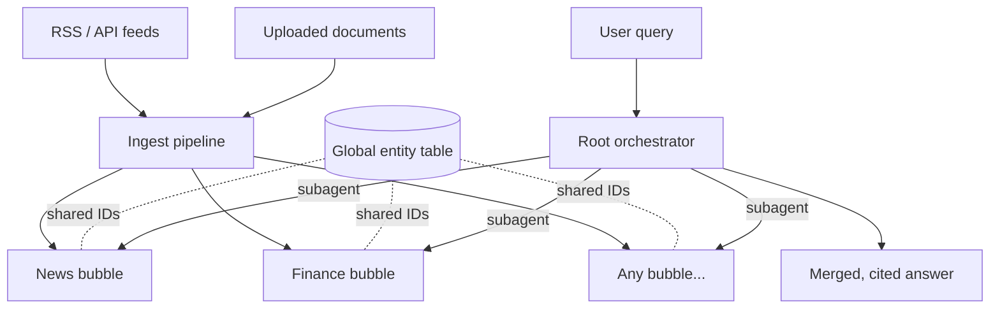

# OmniStream RAG — Project Goal & Design Notes

## 1. Goal

Build a **real-time, multi-graph RAG system** that:

- Continuously ingests information from **RSS feeds, APIs, and uploaded documents**.
- Stores that information in **separate, independent knowledge graphs ("bubbles")**, each focused on one domain (e.g. News, Finance, Research).
- Answers user questions by having an **orchestrator** pick the relevant bubbles and **deploy one subagent per bubble** to explore it, then merge the results into one cited answer.

Example: a question that needs news *and* finance information spawns two subagents — one traversing the News bubble, one traversing the Finance bubble.

---

## 2. Core Concepts

| Concept | What it is |
|---|---|
| **Root / orchestrator** | The entry point. Holds a catalog of all bubbles (name + description). Reads the catalog at query time to decide which bubbles to use. |
| **Bubble** | An independent GraphRAG knowledge graph created through the interface, with a **name** and a **description**. The description acts as the relationship linking it to the root and is what the orchestrator routes on. |
| **Sources** | RSS feeds, API feeds, and documents added via the interface. Each source is assigned to one or more bubbles. |
| **Subagent** | A worker spawned per selected bubble that searches/traverses that bubble's graph and returns ranked, cited findings. |

### What this is called (closest existing terms)

- **Agentic RAG with query routing** — the root is effectively a router.
- **Multi-agent / federated GraphRAG** — several knowledge graphs, each with its own agent.
- **Orchestrator–worker pattern** — one subagent per bubble, then merge.

---

## 3. Architecture

### Ingestion flow

1. **Poll / receive** item (RSS entry, API payload, document).
2. **Deduplicate** — hash normalized text + URL (SHA-256); skip if already seen.
3. **Extract** entities and relations with an LLM (triples + timestamp).
4. **Grounding check** — drop any extracted entity whose mention doesn't appear in the source text (fuzzy partial match, not strict substring).
5. **Resolve entities** against the **global entity table** (embedding match → fuzzy-string fallback → create new).
6. **Write** to the chosen bubble(s), with source ID, URL, source credibility, and validity timestamps.

### Query flow

1. User asks a question.
2. Orchestrator reads the bubble catalog (names, descriptions, embeddings) and selects relevant bubbles.
3. **Simple question** → direct hybrid search across selected bubbles (no subagents).
   **Multi-hop question** → one subagent per bubble, run in parallel.
4. Each subagent ranks its findings with **rank fusion** (relevance + recency + source credibility).
5. Orchestrator merges results, links shared entities across bubbles, and produces a cited answer.

---

## 4. Design Decisions & Recommendations

1. **Root is a catalog, not a full graph.** A list of bubbles with name, description, and a description embedding is enough for routing.
2. **Auto-refresh bubble descriptions.** Periodically regenerate each bubble's description from its actual contents so routing stays accurate as content drifts.
3. **Auto-route ingestion, with manual override.** An LLM classifier suggests the bubble(s) for each item; one item can go to several bubbles (e.g. a bank collapse → News + Finance).
4. **One global entity table shared by all bubbles.** Bubbles reference shared entity IDs, giving cross-bubble links for free ("Apple" in News = "Apple" in Finance).
5. **One database with namespaces**, not one database per bubble.
6. **Don't always spawn subagents.** Use them only for multi-hop questions; give them a cheaper/faster model and a traversal depth cap.
7. **"Learning" = reading the catalog** at query time. A feedback loop (which bubbles produced useful answers) can be added later.
8. **Time-aware facts.** Store `valid_from` / `valid_to` and mark superseded facts as `HISTORICAL` (important for news and finance).
9. **Decay computed at read time.** Recency score = `exp(-λ · age)` computed during the query — no background jobs.
10. **Provenance on every fact** (source ID + URL) so answers can be cited.

---

## 5. Ideas Borrowed from the OmniStreamRAG Capstone Proposal

Taken because they are **easy to implement and genuinely useful**:

- SHA-256 hash deduplication of incoming items.
- Entity resolution: embedding similarity → fuzzy-string fallback → new entity.
  - Gotcha: ChromaDB defaults to L2 distance; create collections with `{"hnsw:space": "cosine"}` if using `1 - distance` as cosine similarity.
- Grounding check on LLM extractions.
- Per-feed **source credibility** weight (a field in the UI).
- `valid_from` / `valid_to` + `HISTORICAL` status for changing facts.
- Reciprocal Rank Fusion with a recency signal.
- Rate-limit queue with backoff for LLM API calls.

### Deliberately skipped (over-engineered)

- Two-tier ephemeral/core graph with Beta-Binomial "crystallization" → instead store facts immediately with `source_count` and per-source credibility, and let ranking handle trust.
- NLI cross-encoder gating of every claim against the graph → slow, and unclear what to compare against.
- "Adversarial amplification" rate limiter (20 updates / 60 s) → would block legitimate breaking-news bursts.
- Sibling correlation discount and location-based "quintuples" → triples + timestamp are enough.
- Three separate stores (SQLite + Neo4j + ChromaDB) → painful to keep in sync.

---

## 6. Suggested Stack

| Layer | Choice |
|---|---|
| Backend | Python + FastAPI |
| Feed polling | `feedparser` + a scheduler (e.g. APScheduler) |
| Knowledge graph | **Graphiti** (real-time incremental updates, bi-temporal facts, group IDs ≈ bubbles) |
| Graph DB | Neo4j or FalkorDB (with built-in vector index) — or Postgres + pgvector |
| Embeddings | Small local sentence-embedding model |
| LLMs | Stronger model for orchestrator/answers; cheaper/faster model for extraction and subagents |
| UI | Simple web UI: create bubbles, add feeds/documents, assign to bubbles, ask questions |

---

## 7. Data Model (sketch)

- **bubbles**: `id`, `name`, `description`, `description_embedding`, `auto_summary`, `updated_at`
- **sources**: `id`, `type` (rss / api / document), `url`, `credibility`, `poll_interval`, `bubble_ids[]`
- **seen_items**: `hash`, `source_id`, `first_seen_at`
- **entities** (global): `id`, `canonical_name`, `type`, `aliases[]`, `embedding`
- **facts / edges** (per bubble): `subject_id`, `relation`, `object_id`, `bubble_id`, `source_id`, `source_url`, `credibility`, `source_count`, `valid_from`, `valid_to`, `status` (VERIFIED / HISTORICAL), `ingested_at`

---

## 8. MVP Plan

1. Feed poller + document upload + hash dedup.
2. Graphiti on Neo4j/FalkorDB, one group per bubble, global entity resolution.
3. Web UI for bubbles and sources.
4. Orchestrator: select bubbles from descriptions → parallel subagents → merge with citations.
5. Small evaluation set of test questions (single-bubble, cross-bubble, time-sensitive).

---

## 9. Hard Parts / Risks

- **Extraction cost** — LLM extraction on every feed item adds up; filter and dedupe first.
- **Entity quality** — duplicate entities ruin graph quality; entity resolution is the most important component.
- **Routing accuracy** — vague bubble descriptions lead to wrong bubbles; auto-refresh descriptions.
- **Evaluation** — without a test question set, it's impossible to tell if routing and answers are improving.

---

## 10. Open Questions

- Should bubbles be allowed to contain sub-bubbles (hierarchy), or stay flat?
- How should conflicting facts across bubbles be presented — newest wins, highest credibility wins, or show both?
- Should users control which bubbles a query may access (permissions), or always let the orchestrator decide?
- When (if ever) to add routing feedback learning?
